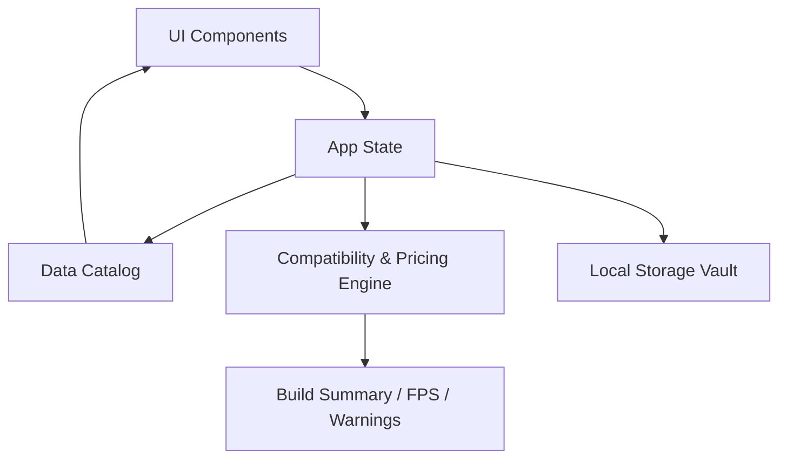

# RIGFORGE — PC Build Lab (India Edition)

> A premium PC building simulator focused on the Indian market, built with React, Vite, and Tailwind CSS.


RIGFORGE is an interactive web app that lets users configure a custom desktop PC by choosing a **CPU, cooler, motherboard, RAM, storage, GPU, PSU, and cabinet**, while receiving **live compatibility validation**, **Indian rupee price calculations**, **wattage guidance**, and **estimated gaming performance**.

It is designed as a **web lab edition** of a broader product idea that can later be extended into a **React Native + Firebase mobile app**.

---

## Table of Contents

- [Overview](#overview)
- [Problem It Solves](#problem-it-solves)
- [Use Cases](#use-cases)
- [Key Benefits](#key-benefits)
- [Core Features](#core-features)
- [Architecture](#architecture)
- [Project Structure](#project-structure)
- [How the App Works](#how-the-app-works)
- [Technology Stack](#technology-stack)
- [Data Model](#data-model)
- [Compatibility Engine](#compatibility-engine)
- [Performance Estimation Model](#performance-estimation-model)
- [State Management & Persistence](#state-management--persistence)
- [Design System](#design-system)
- [Setup & Development](#setup--development)
- [Build for Production](#build-for-production)
- [Customization Guide](#customization-guide)
- [Roadmap](#roadmap)
- [Why This Project Stands Out](#why-this-project-stands-out)
- [License](#license)

---

## Overview

Building a gaming or creator PC is exciting, but it is also confusing for many users:

- Which processor fits which motherboard?
- Does the selected RAM work with the board?
- Will the cabinet support the motherboard form factor?
- Is the power supply strong enough for the CPU + GPU combination?
- Is the total budget still under control?
- What kind of gaming performance can the user expect?

RIGFORGE solves these questions in a single, highly visual simulator.

This project is especially tailored for:

- **Indian buyers** who want pricing in **₹ INR**
- **PC enthusiasts** who want to test parts quickly
- **Students and beginners** learning PC compatibility
- **Developers/designers** who want an example of a polished React configurator app

---

## Problem It Solves

Most users research PC builds across multiple tabs:

- one site for CPU specs
- another for motherboard compatibility
- another for GPU performance
- another for PSU recommendations
- another for pricing

That process is slow and error-prone.

RIGFORGE combines these concerns into a single interface by providing:

1. **A curated component catalog**
2. **Real-time compatibility rules**
3. **Live total pricing in Indian rupees**
4. **Power draw estimation**
5. **Gaming/creator score estimation**
6. **Saved builds for later review**

---

## Use Cases

### 1. First-time PC builder
A beginner can choose parts one by one and instantly learn whether a motherboard socket, RAM type, or PSU wattage is correct.

### 2. Budget gaming build planning
A student or gamer can load a one-click preset and then swap individual parts to fit a target budget.

### 3. Performance-focused configuration
A user comparing 1080p/1440p gaming options can see how a CPU/GPU combination changes estimated FPS and bottleneck behavior.

### 4. Local PC shop demo tool
A computer store or small builder can use this app as a visual consultation tool while discussing component choices with customers.

### 5. Prototype for a larger product
This codebase already contains the structure needed for extension into:
- a cloud-synced build planner
- a React Native mobile client
- a Firebase-backed user vault
- live e-commerce pricing integration

---

## Key Benefits

### For Users
- Faster PC build planning
- Fewer compatibility mistakes
- Better budget visibility
- Clear visual presentation of components
- Easy comparison of build quality and performance

### For Developers
- Clean separation of **data**, **logic**, and **presentation**
- Easy-to-edit component catalog in one file
- Reusable compatibility engine
- Expandable architecture for future APIs or mobile apps
- Strong example of a polished single-page React application

---

## Core Features

- **8 build categories**
  - CPU
  - CPU Cooler
  - Motherboard
  - Memory
  - Storage
  - GPU
  - PSU
  - Cabinet

- **Indian pricing engine**
  - Proper INR formatting using Indian numbering style
  - Example: `₹1,02,400`

- **Live compatibility checks**
  - CPU ↔ motherboard socket
  - RAM ↔ motherboard generation
  - Cooler ↔ CPU socket support
  - Motherboard ↔ cabinet fit
  - PSU headroom estimation

- **Performance estimation**
  - Gaming score
  - Creator score
  - Bottleneck hint
  - Game-wise FPS estimates

- **One-click presets**
  - Budget starter build
  - Esports build
  - Creator build
  - Flagship build

- **Saved build vault**
  - Save builds locally
  - Reload previous builds
  - Delete outdated builds

- **Spec sheet export**
  - Copy a text summary of the current build

- **Custom visual design**
  - Dark blueprint aesthetic
  - Animated boot sequence
  - Product photography for parts/cabinets
  - Responsive layout

---

## Architecture

The project follows a **layered frontend architecture**:



### Architectural Layers

#### 1. Presentation Layer
Located in `src/components/`

Responsible for:
- rendering sections
- visual layout
- animations
- user actions
- displaying build details and warnings

#### 2. State & Composition Layer
Located in `src/App.jsx`

Responsible for:
- global page composition
- current selected parts
- active builder section
- toast notifications
- saved builds drawer state
- copy/save/reset actions

#### 3. Domain Data Layer
Located in `src/data/parts.js`

Responsible for:
- the parts catalog
- category metadata
- pricing values
- specs used by the UI and engine
- build presets

#### 4. Business Logic Layer
Located in `src/lib/engine.js`

Responsible for:
- INR formatting
- total price calculation
- power draw estimation
- compatibility analysis
- bottleneck logic
- FPS estimation
- spec sheet text generation

#### 5. Persistence Layer
Handled in `src/App.jsx` via browser `localStorage`

Responsible for:
- storing saved builds
- restoring saved builds on reload

---

## Project Structure

```text
.
├── public/
│   └── images/                 # Component and cabinet images
├── src/
│   ├── components/             # UI components
│   │   ├── AnimatedINR.jsx
│   │   ├── BuildSheet.jsx
│   │   ├── Builder.jsx
│   │   ├── FastLane.jsx
│   │   ├── Footer.jsx
│   │   ├── Hero.jsx
│   │   ├── Intro.jsx
│   │   ├── Marquee.jsx
│   │   ├── Nav.jsx
│   │   ├── SavedDrawer.jsx
│   │   └── Toasts.jsx
│   ├── data/
│   │   └── parts.js            # Catalog, categories, presets
│   ├── lib/
│   │   └── engine.js           # Pricing, compatibility, FPS logic
│   ├── utils/
│   │   └── cn.js               # Class name utility
│   ├── App.jsx                 # Main app logic and composition
│   ├── main.jsx                # React entry point
│   └── index.css               # Global styles and theme
├── index.html
├── package.json
├── tsconfig.json
└── vite.config.ts
```

---

## How the App Works

### Step 1: User selects components
The user opens a category and picks one part.

### Step 2: App updates global selection state
The chosen part is stored in the build state inside `App.jsx`.

### Step 3: Engine recalculates everything
The app immediately recalculates:
- total price
- power draw
- compatibility checks
- FPS estimates
- build summary

### Step 4: UI reflects the new state
The right-side build sheet updates live, showing:
- estimated performance
- compatibility matrix
- price breakdown
- save/copy actions

### Step 5: Build can be saved locally
The user can save the build into a local vault using `localStorage`.

---

## Technology Stack

### Core Frontend
- **React 19** — component-based UI architecture
- **Vite 7** — fast development server and production build tool
- **JavaScript (ES Modules + JSX)** — app logic and components

### Styling & UI
- **Tailwind CSS v4** — utility-first styling
- **Custom CSS theme tokens** in `src/index.css`
- **Lucide React** — icon system
- **Framer Motion** — transitions and motion effects

### Utilities
- **clsx** — conditional class composition
- **tailwind-merge** — safe Tailwind class merging

### Persistence
- **localStorage** — build vault persistence in the browser

### Deployment Output
- **vite-plugin-singlefile** — optimized single-file HTML output for easy deployment

---

## Data Model

The catalog is intentionally centralized in one place: `src/data/parts.js`.

Each part object includes values like:
- `id`
- `category`
- `maker`
- `name`
- `price`
- `tier`
- `image`
- `blurb`
- `stats`
- optional compatibility properties such as:
  - `socket`
  - `socketSupport`
  - `memType`
  - `formFactor`
  - `caseSupport`
  - `watt`
  - `capacity`

This makes the app very easy to maintain because:
- adding a new component usually means just adding a new object
- changing a price needs only one edit
- presets can be updated without touching UI logic

---

## Compatibility Engine

The compatibility engine is the brain of the application.

It currently validates:

### CPU ↔ Motherboard
Checks whether both use the same socket, such as:
- `LGA1700`
- `AM4`
- `AM5`

### RAM ↔ Motherboard
Checks whether RAM type matches board support:
- `DDR4`
- `DDR5`

### Cooler ↔ CPU
Checks whether the selected cooler supports the CPU socket.

### Motherboard ↔ Cabinet
Checks whether the case supports the selected motherboard form factor:
- `ITX`
- `mATX`
- `ATX`
- `E-ATX`

### PSU Headroom
Compares estimated load vs PSU wattage and warns if:
- the PSU is too weak
- the PSU works but has tight headroom
- the PSU has safe overhead

### Option-level Verdicts
Even before a user selects a component, each option can show:
- safe match
- warning
- hard incompatibility

This improves usability because the app is not only validating the final build — it also guides the user during selection.

---

## Performance Estimation Model

The app includes a lightweight simulation model in `src/lib/engine.js`.

It is not meant to replace benchmark databases, but it gives users a useful directional estimate.

### Inputs used
- CPU tier
- GPU tier
- RAM capacity bonus
- title-specific multipliers
- CPU-heavy game weighting

### Outputs shown
- estimated FPS for multiple games
- gaming score
- creator score
- bottleneck classification

### Why this is useful
It helps users understand:
- whether a CPU is too weak for a powerful GPU
- whether a GPU is overkill for the chosen processor
- whether a build is balanced for gaming vs content creation

---

## State Management & Persistence

### State management
This project uses **React hooks** instead of a global store library.

Primary hooks used:
- `useState`
- `useEffect`
- `useMemo`
- `useCallback`

This is a good fit because the app is a single-page configurator with a contained state model.

### Persistence
Saved builds are stored in the browser using `localStorage`.

This means:
- builds survive page refreshes
- no backend is required
- the app stays simple and portable

A future upgrade path would be replacing local storage with:
- Firebase Authentication
- Firestore build syncing
- user profiles and cloud backup

---

## Design System

The design aims to feel like a **premium PC hardware dashboard** rather than a generic form.

### Visual style
- dark UI theme
- blueprint grid overlays
- neon lime accent color
- glassmorphism panels
- motion-heavy interactions
- editorial typography

### Typography
- **Space Grotesk** for display text
- **JetBrains Mono** for technical/system text

### Motion design
Framer Motion is used for:
- intro boot sequence
- section entrance animations
- panel expansion
- progress bars
- floating hero chips
- toasts and drawer transitions

---

## Setup & Development

### Prerequisites
- Node.js 20.19+ or 22+
- npm

### Install dependencies

```bash
npm install
```

### Start development server

```bash
npm run dev
```

Then open:

```text
http://localhost:5173
```

---

## Build for Production

To create the production build:

```bash
npm run build
```

Output is generated inside:

```text
dist/
```

Because the project uses a single-file Vite plugin, deployment is extremely easy.

You can host it on:
- Netlify
- Vercel
- GitHub Pages
- Firebase Hosting
- any static hosting service

---

## Customization Guide

### Change prices or add parts
Edit:

```text
src/data/parts.js
```

### Change compatibility or scoring logic
Edit:

```text
src/lib/engine.js
```

### Change theme colors, fonts, animations
Edit:

```text
src/index.css
```

### Change page structure or state behavior
Edit:

```text
src/App.jsx
```

### Change section designs
Edit individual files in:

```text
src/components/
```

---

## Roadmap

Potential next improvements:

- [ ] Compare two builds side by side
- [ ] Add peripherals as new categories
- [ ] Add monitor resolution presets
- [ ] Add filter/search inside categories
- [ ] Connect real-time pricing APIs
- [ ] Export build sheet as image/PDF
- [ ] Add shareable build URLs
- [ ] Add user accounts and cloud sync with Firebase
- [ ] Port UI and core logic into a React Native app

---

## Why This Project Stands Out

RIGFORGE is more than a catalog viewer.

It combines:
- product selection
- domain rules
- pricing logic
- simulated performance
- strong visual identity
- persistent user workflows

That makes it a strong portfolio project because it demonstrates:

### Frontend engineering
- component architecture
- state-driven rendering
- conditional UI logic
- persistence handling
- build tooling knowledge

### Product thinking
- solving a real user problem
- designing for a niche market (India)
- adding educational value through compatibility hints
- balancing aesthetics with utility

### Scalability potential
The project is already structured in a way that supports future migration to:
- mobile clients
- backend integration
- cloud sync
- real data APIs

---

## License

This project is available for personal, educational, and portfolio use.

If you want, you can add an MIT `LICENSE` file to make the repository fully open-source.

---

## Author Note

If you are viewing this project on GitHub, this repository represents the **web edition** of RIGFORGE.
The long-term product vision includes a **React Native frontend** and **Firebase backend** for mobile-first build planning and synced user vaults.
